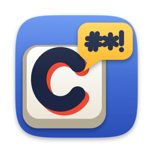

# RuSwitcher Pro

<p align="center">
  
</p>

<p align="center">
  <b>Local EN↔RU keyboard-layout switcher for macOS</b><br>
  A practical, privacy-first alternative to PuntoSwitcher and Caramba
</p>

<p align="center">
  <a href="https://github.com/yelloduxx/RuSwitcher/tags"></a>
  <a href="LICENSE"></a>
  
  
  
</p>

<p align="center">
  <a href="#english">English</a> · <a href="#русский">Русский</a>
</p>

---

## English

Typed `ghbdtn` when you meant `привет`? By default, tap **Shift twice** and RuSwitcher Pro converts the last word in place. Manual conversion works with any two installed layouts; automatic conversion is tuned and tested for EN↔RU. The trigger remains configurable, and auto-conversion can fix a wrong layout at the end of a word.

The current `main` build is **4.0.0 (129)**. It uses Smart Engine V3.1 as the only production decoder. V4 remains an isolated research package and is not loaded by the application.

### How it works

| Action | Result |
|---|---|
| Type a word, tap **Shift** twice | Last word before the caret is converted |
| Tap **Shift** twice again | Reverse conversion (toggle back) |
| Select text, tap **Shift** twice | Selected text is converted |

The default is double Shift. The trigger is configurable — **Option**, **Command**, **Control** or **Shift** (left or right side, single or double-tap), or a **two-key combo** (⌘+⇧, ⌃+⇧, ⌘+⌥, ⌃+⌥) for the Windows-style Alt+Shift feel. A real selection always has priority. Without a selection, RuSwitcher Pro converts the current or just-completed buffered word. After navigation or a focus change it can recover the exact word before the caret only when that text field exposes readable Accessibility text.

### Automatic conversion

RuSwitcher Pro can also fix the layout **automatically as you type**, with no key press. Turn it on in **Settings → Auto-conversion** (off by default). The production Smart Engine V3 is a fully local noisy-channel decoder. It compares the literal and opposite-layout hypotheses using word frequency, RU/EN spelling data, character n-grams, recent phrase language, compound analysis and learned manual corrections. It abstains when the evidence is unsafe.

It handles common short words (`b` → `и`, `z` → `я`), long words such as `ghbdtncnde.` → `приветствую`, trailing punctuation (`ghbdtn,` → `привет,`) and unknown compounds such as `cegthcgbyf` → `суперспина` (`супер` + `спина`). Corrections happen only after Space, Enter or Tab, never halfway through a word; punctuation remains part of the token until that boundary so repeated marks cannot be corrupted by a mid-sequence layout switch. To avoid dangerous false fixes it skips words with digits / URLs / email-like text, single uppercase Latin letters (`plan B`), unlearned ALL-CAPS acronyms, camelCase / mixed-script code identifiers, terminals / IDEs / password managers, and password fields. A plain multi-letter acronym can be taught explicitly with the manual trigger; structured identifiers remain blocked.

For Latin input, an English-first source gate protects frequent words and a separate 80,000+ form ESDB/SCOWL spelling lexicon before considering RU conversion. Words outside both dictionaries are classified by English character probability: plausible English OOV forms get a keep bias, while English-unlikely physical-key strings may switch when the Russian hypothesis has stronger lexical, character or contextual evidence. For RU→EN, V3.1 ranks exact English spellings by reproducible SCOWL common/standard/rare tiers and combines that rank with character plausibility and phrase context. It converts only when the Cyrillic source is unknown and the candidate has at least four letters; a valid Russian source, code-like text and other hard blockers still win. This fixes whole classes of real English words that the former single character threshold missed, without per-word overrides.

Russian spelling evidence uses an offline-expanded LibreOffice Hunspell dictionary represented by a compact 4 MB Bloom filter with more than one million inflected forms. It confirms words such as verb imperatives without adding per-word exceptions and protects valid Russian source forms. When both physical interpretations are real words (`туче`/`next`), RuSwitcher Pro keeps the literal text unless explicit learning provides stronger evidence.

The input state is revision-based: Backspace updates the current physical token, while word deletion, navigation, Cut/Paste/Undo, mouse clicks and focus changes invalidate stale state. Before an automatic replacement RuSwitcher Pro performs a read-only Accessibility check when the target supports it, then posts one ordered replacement transaction. This prevents stale selection, duplicate insertion and deletion at the wrong caret.

Undoing an automatic correction or immediately editing it provides local negative feedback; a successful manual conversion creates an explicit global confirmation. One-character pairs are deliberately not persisted, so an accidental correction cannot make ordinary `а` or `и` change everywhere. In an AX-blind field, an unverified manual correction is held provisionally: the next ordinary keystroke or a 1.2-second grace period confirms it, while Backspace, Delete, Undo, Cut/Paste or another double Shift cancels it. Learned word pairs and their counters can be exported to a versioned JSON backup and merged back through **Settings → Advanced**. Reimporting the same file is safe and does not duplicate rules. Learned state can also be reset there. The explicit **Always convert** and **Never convert** lists remain hard overrides.

#### Apps without readable Accessibility text

Some terminals and Chromium/Electron editors do not expose the text before the caret. Manual double Shift still converts a freshly typed buffered word without destructive Backspace: RuSwitcher Pro selects the exact suffix with marked Shift+Left events and types the opposite-layout physical keys over that selection. It cannot recover an arbitrary old word after navigation or a focus change if the host exposes no text.

Automatic conversion in such hosts is available through **Settings → Auto-conversion → Also in apps without Accessibility** and is off by default. This mode cannot verify the text by read-back, so it relies on the current focus and input revision. Keep terminals or other sensitive tools in the application exception list unless you deliberately accept that trade-off. Password managers and secure-input fields remain blocked.

#### Native Input Method companion (experimental)

The source tree also contains `RuSwitcherInputMethod`, a separate InputMethodKit
input source with EN and RU modes. It keeps the unfinished token as macOS marked
text, runs the same production V3 decoder at Space, Enter or Tab, and commits the
chosen spelling exactly once. Automatic correction therefore uses no AX read,
CGEvent deletion, Backspace burst or pasteboard. Double Shift can toggle the
marked token, a real selection, or the word immediately before the caret through
the standard `IMKTextInput` contract. While either companion mode is active, the
menu-bar application's global event tap stays transparent so the two paths cannot
convert the same token.

This is an optional compatibility mode, not a universal replacement. It works in
clients that implement the macOS text-input protocol. Raw terminal surfaces,
games, remote sessions, secure fields and fully custom editors may bypass or
restrict input methods; use the normal RuSwitcher Pro event-tap mode there.

**Three exception lists** let you tune it (Settings → Auto-conversion):
- **Apps** — where auto-conversion stays off (terminals, IDEs and password managers are pre-filled; password managers can't be removed).
- **Never convert** — words it must never touch (nicknames, logins, brands). After a wrong fix, tap the trigger to undo and RuSwitcher Pro offers to add the word here.
- **Always convert** — words to always fix even if they aren't in the dictionary (compound words, slang). Add the **target** word — the result you want.

### Remote desktop (beta — new in 2.5)

RuSwitcher Pro works through **Apple Screen Sharing**. Type into a remote Mac's session and fix wrong-layout text right there — by trigger or automatically — just like on your local machine. Run RuSwitcher Pro on **both** Macs and turn on **Remote Desktop mode** (beta, marked in the menu). Conversion happens on the Mac you're controlling, where the text actually lives.

### Layout flag at the cursor (beta — new in 2.6)

After you switch layout, RuSwitcher Pro can briefly show the layout flag **right next to the text cursor** — so you see which layout you're in without glancing at the menu bar. It hides as you start typing. Turn it on in the menu or Settings (off by default). It works wherever the app exposes the cursor position via Accessibility (native apps and most text fields); a few apps that draw their own text (e.g. the VS Code editor) don't expose it — there macOS's own input indicator covers the gap.

### Features

- **Any two layouts manually** — configure any pair from your installed system layouts. Automatic quality is focused on EN↔RU.
- **Switch layout from the menu** *(new in 2.6.1)* — pick any installed layout right from the menu-bar menu (flag, name, a check on the current one) and click to switch.
- **Double Shift by default** — configurable as Option, Command, Control or Shift (left/right, single/double-tap), or a two-key combo like ⌘+⇧.
- **Automatic conversion** — optionally fix the layout as you type, including common short words and trailing punctuation. Off by default.
- **Remote desktop (beta)** — fix the layout over Apple Screen Sharing, on the Mac you're controlling.
- **Exception lists** — a per-app exclusion list plus never-convert and always-convert word lists.
- **Layout sound (optional)** — a short sound on the first letter after a layout change, so you *hear* which layout you're in.
- **Layout flag at the cursor (beta)** — briefly show the layout flag next to the text cursor right after a switch.
- **Monochrome menu-bar icon (optional)** *(new in 2.6.1)* — a system-style `РУ/EN` badge instead of the colored flag; adapts to light/dark automatically. Off by default.
- **Universal binary** — runs natively on both Apple Silicon and Intel Macs.
- **Clipboard-free normal path** — automatic conversion and current/previous-word manual conversion type the replacement directly. A selected-text fallback may briefly use the pasteboard when AX cannot read the selection; it preserves all types and restores the old contents only while RuSwitcher Pro still owns the temporary value.
- **Smart word detection** — converts the last typed word, including punctuation, or the word immediately before the caret after navigation.
- **Selected text** — select any text and tap the trigger to convert it in place.
- **Tap again to undo** — reverse conversion if you changed your mind.
- **Per-app layout memory** — remembers the active layout for each application and restores it when you switch back.
- **16 interface languages** — English, Русский, Українська, Беларуская, Deutsch, Français, Español, Português, Polski, 中文, 日本語, 한국어, Ελληνικά, Български, Հայերեն, ქართული.
- **Auto-start at login** — set and forget.
- **Minimal footprint** — no Electron, no web views, pure Swift + AppKit.
- **Private by default** — decoding, context and learned corrections stay on this Mac; no usage statistics are collected.

### Installation

This fork is installed separately as **RuSwitcher Pro**, so it can coexist with
the author's original `RuSwitcher.app`. It currently publishes beta tags but no
DMG or Homebrew release. Build it from source:

```bash
git clone https://github.com/yelloduxx/RuSwitcher.git
cd RuSwitcher
SIGN_ID="<your code-signing identity>" bash build_app.sh
ditto "RuSwitcherPro.app" "/Applications/RuSwitcherPro.app"
open "/Applications/RuSwitcherPro.app"
```

To build and register the optional native Input Method companion:

```bash
SIGN_ID="<your trusted code-signing identity>" bash build_input_method.sh
bash scripts/install_input_method.sh
```

Then enable **RuSwitcher EN** and **RuSwitcher RU** in System Settings → Keyboard
→ Text Input. Input methods are launched by a protected macOS service. On current
macOS, activation requires an Apple-issued Apple Development or Developer ID
identity; the reusable self-signed identity can build and verify the bundle but
AMFI will not launch it, even after adding it to user or System trust.

Requires macOS 13+, Xcode Command Line Tools and a trusted code-signing identity. Local project builds use the reusable `RuSwitcher Local Code Signing` identity. The build script creates a universal `arm64`/`x86_64` bundle, verifies its signature and stops if Gatekeeper rejects it.

### Permissions

On first launch, RuSwitcher Pro requests two macOS permissions:

1. **Accessibility** — to read and modify text in applications.
2. **Input Monitoring** — to detect keyboard events.

The app adds itself to the permission lists automatically — you only need to flip the toggles. The built-in permission wizard walks you through it step by step.

### Technical details

- An active `CGEventTap` for ordered automatic replacement; synthetic events are marked and ignored by the state machine.
- `UCKeyTranslate` (Carbon) for dynamic character mapping between any layout pair.
- Targeted `CGEvent` transactions for automatic replacement and physical target-layout key events for AX-blind manual conversion.
- `CGEvent.keyboardSetUnicodeString` for direct replacement text where appropriate — no clipboard in the normal word-conversion path.
- `CGEventSource.userData` marker to filter the app's own simulated events.
- Event-tap state is reset and the tap is recreated with bounded retries after
  macOS wake or session unlock.
- A memory-mapped, versioned local RU/EN language model generated from pinned Google Books n-gram frequency data and reproducible SCOWL 35/50/60 spelling tiers.
- A Core ML V4 research package under `Experimental/V4`; it is absent from the normal package graph and production application.
- Read-only `AXUIElement` range probes for focus and suffix validation; selected-text conversion uses AX first and preserves every pasteboard type in its fallback.
- `SMAppService` for login item management.
- Dynamic Carbon translation for configured manual-layout pairs; the production V3 decoder and language model are intentionally EN↔RU-specific.

### Simulation and quality testing

`RuSwitcherSimulator` runs the V3 decoder against generated or JSONL fixtures in parallel, without Accessibility permissions or keyboard emulation:

```bash
swift run -c release RuSwitcherSimulator --jobs 8 --output simulation.json
```

`--input fixtures.jsonl` accepts custom words, `--phrase-input phrases.jsonl` accepts stateful mixed-language phrases, and `--phrase-results results.jsonl` writes a complete step trace. The existing `scripts/run_headless_typing_simulator.sh` is a **legacy text/ideal-delivery** check: it feeds literal characters through `InputSession`, V3 and replacement plans. It does not prove physical input, asynchronous delivery or manual learning. Its expected verdicts no longer set the next token's input language. Independent legacy phrases can run in parallel:

```bash
python3 scripts/run_mixed_layout_event_stream_suite.py corpus.tsv --jobs 8
```

Corpus wrappers use unique run directories and validate fresh complete results before publishing an audit. Missing, stale, truncated or empty results cannot count as a successful run. The original TSV and the physically reconstructed test input are distinct: this legacy importer reconstructs wrong-layout tokens from the intended text. The 5,000-phrase corpus is a regression set with a small repeated vocabulary, not a broad independent language-quality benchmark.

The **physical-key/scheduled-delivery** mode reads keyDown/keyUp, explicit user layout changes, caret movement, focus changes and tap recovery. The next character comes from the actual simulated active layout using macOS layout data; the expected answer is passed only to a separate assessor:

```bash
python3 scripts/run_physical_typing_suite.py
swift run -c release RuSwitcherTypingSimulator \
  --physical-input Tests/Fixtures/Simulator/physical-closed-loop.json \
  --output .build/physical-report.json
```

The runner uses the production local-key classifier, replacement coordinator/driver and staged InputSession transitions. A virtual clock independently schedules each synthetic event, layout delivery, read-back and acknowledgement. A UTF-16/grapheme-aware editor tracks text, selection and revision. Reports include the complete synthetic trace, context, confirmations, layout checkpoints, and model/layout/fixture hashes. No desktop layout is selected.

Input arrival and callback processing are now separate. `conversionPrePostMicroseconds` and `conversionPostWorkMicroseconds` in `stimulus.timing` occupy the callback lane while input timestamps and editor delivery continue independently. Arrival-time characters, processing-time layout, waiting time and delivered characters are reported separately. The shared `QueuedLayoutTransition` fixes the reproduced first-letter race; `--fault no-queued-layout-sync` restores the bad result. The suite also demonstrates that a zero-work profile hides that regression. Costs default to zero for compatibility and are explicit stress parameters, not a calibrated replay of macOS scheduling. Hypothetically late delivery still fails instead of being serialized away.

Native event-construction tests additionally allocate real CGEvent objects without posting them. The complete replacement, including replay boundaries, must be prepared before publication; an allocation failure on the final event cannot start a partial replacement.

The app and scheduled physical simulator now share `AutomaticConversionPlanner`: V3 evaluation, keep handling and exact replacement-request preparation. Seven focused tests cover context, punctuation, policy precedence, confirmed acronyms, missing prerequisites and transaction identity. This removes duplicated preparation, but does not make virtual delivery or learning equivalent to the native app.

An external three-process harness is available via `python3 scripts/run_external_native_suite.py --prepare-only`. Preparation opens no windows and is **not** a native pass. Live execution needs explicit focus permission and OS event access, and uses a separate NSTextView receiver (default) or a WKWebView textarea (`--editor webkit`) plus a timestamp-driven producer. Both receivers have passed the short continuous automatic code-switch phrase. WebKit also passed the rolling-Space case with the next key arriving after 5 ms: exact text/caret/layout, fresh final DOM read, matching AppKit/DOM keyboard counts and an independent auto-off control. The WebKit page is local, nonpersistent and has no network access or expected-text input. This is not evidence for Chromium/Electron, Codex, terminals or manual conversion.

`--preflight-only` builds/signs and reads access flags without opening an editor or stopping the installed app. Even granted access is reported as `permissionsReadyNotRun`, not a test pass. The native assessor matches individual action markers and requires the auto-off control to match its own literal-text oracle; lost or duplicated input cannot serve as a successful negative control. Final host snapshots recheck the actual editor and focus before reporting completion.

Completed native reports are archived under `.build/native-runs/<runID>` so restarting macOS does not erase the evidence. Test bundles stay temporary. Standard permission prompts are separate, explicit `--request-access` actions; the read-only preflight never requests access.

The short external AppKit fixture passed on September 10: a continuous 93-character RU/EN/RU phrase matched exactly, including `plan B`, punctuation, caret/layout checkpoints and three verified automatic conversions. Its auto-off control independently matched the literal wrong-layout text with zero conversions. Process-scoped Quartz and AppKit traces contained every expected original key-up, without duplicates or interference (run `28baa820-e962-4f3d-a1af-25652da0bb10` under `.build/native-runs`). **This is not a complete release pass:** an earlier missing key-up did not recur but is not explained; the separate zero-gap manual-layout failure and rapid-overlap acceptance remain unresolved. Observation can affect timing. Installed build 130 was restored unchanged.

The suite detects missing layout switches, disabled conversion, lost deletion/insertion, duplication and oracle-dependent input. The unreleased replacement path now confirms the exact field, expected caret and a bounded prefix plus replacement, rather than only the suffix. Lost deletion/duplicate insertion are rejected as unverified damage; they are not automatically repaired. Delayed replacement events can still damage the next word, which remains an **unfixed modeled failure**. A passing harness means these intentionally broken runs were detected, not that production delivery is reliable. `stimulus.timing` accepts microsecond delays for delivery, synthetic-event intervals, layout changes, verification reads and acknowledgements; it models an environment, not measured macOS timings.

The unreleased keyboard-deletion path also refuses complex Unicode suffixes whose Backspace count is ambiguous. Windowless tests using real NSTextView editing reproduced preceding-text deletion with the old UTF-16/physical-key counts and verify the guard. Ordinary EN/RU suffixes use their text length; real AX selection replacement is unchanged. This fix is not yet installed and does not resolve delayed-delivery overlap.

Preflight is still synchronous. Modified host commands, automatic dead-key composition and manual learning remain unsupported here; this is not the complete AppDelegate/AX/CGEvent path. Native delivery needs an external host in an isolated macOS session; an in-process NSTextView result cannot establish compatibility with Electron or terminals. V4 remains separate: `swift test --package-path Experimental/V4`.

Source baseline for build 130 (`de45597`, before the new validation work):

- **202 tests:** 201 passed, 1 skipped because the international layout was not enabled, 0 failed. Test-only layout lookup now also reads installed-but-disabled layouts without enabling them, so that quote-composition test can actually run.
- **5,000 mixed-layout phrases / 59,388 labelled tokens:** 58,938 exact (99.2423%); all 450 failures were safe misses, with zero false or wrong replacements and zero duplicate transactions. A clean build-126 checkout produces the same 450 misses.
- **New ranked-English gates:** at least 90% held-out recall in every SCOWL tier, plus zero false replacements across 50,000 frequent correct tokens, 50,000 extended English spellings and more than 3,000 generated Russian OOV forms.
- **Native release gate:** probes verify the exact RuSwitcher Pro bundle ID, build and executable hash, stage app-facing files in `/tmp`, and report `blocked` unless an isolated session or explicit focus permission is provided.
- **CI:** every push and pull request runs tests, warnings-as-errors, ASan, deterministic simulators, the negative control and byte-for-byte model reproduction on macOS.

RuSwitcher Pro contains no usage-statistics reporter or endpoint.

### Settings

Access via the menu bar icon → **Settings** (⌘,).

- **General** — conversion trigger (single key or combo), per-app layout memory, launch at login, interface language, layout pair.
- **Auto-conversion** — automatic conversion, optional AX-blind-host mode, **Remote Desktop mode (beta)**, and the three exception lists (apps, never-convert, always-convert).
- **About** — version, donate, contact, check updates.
- **Advanced** — Smart Engine/model version, learned-word export/import/reset, debug logging and log management.

The menu-bar menu also has quick toggles for Automatic conversion, Layout sound, Flag at cursor and Remote Desktop mode.

### Support the project

If you find RuSwitcher Pro useful:

- [**Boosty**](https://boosty.to/ruswitcher) — donate
- **Star** this repo on GitHub

### License

[MIT](LICENSE) — free to use, modify, and distribute.

---

## Русский

Набрали `ghbdtn` вместо `привет`? По умолчанию нажмите **Shift два раза** — и RuSwitcher Pro сконвертирует последнее слово прямо у каретки. Ручная конвертация работает с любой парой установленных раскладок; автоконверсия настроена и проверена для EN↔RU. Триггер настраивается, а автоконверсия исправляет неверную раскладку на границе слова.

Текущая версия в `main` — **4.0.0 (build 130)**. В приложении работает только продакшен-движок Smart Engine V3.1. V4 остаётся отдельным исследовательским пакетом и приложением не загружается.

### Как работает

| Действие | Результат |
|---|---|
| Набрать слово, нажать **Shift** два раза | Сконвертировано последнее слово перед кареткой |
| Нажать **Shift** два раза повторно | Обратная конвертация (переключение назад) |
| Выделить текст, нажать **Shift** два раза | Выделенный текст сконвертирован |

По умолчанию используется двойной Shift. Триггер настраивается — **Option**, **Command**, **Control** или **Shift** (левый или правый, одиночный или двойной тап), либо **комбо из двух клавиш** (⌘+⇧, ⌃+⇧, ⌘+⌥, ⌃+⌥) — в стиле привычного Alt+Shift. Настоящее выделение всегда имеет приоритет. Без выделения RuSwitcher Pro конвертирует текущее или только что завершённое слово из внутреннего буфера. После навигации или смены фокуса точное слово перед кареткой можно восстановить только в поле, которое отдаёт читаемый текст через Accessibility.

### Автоматическая конверсия

RuSwitcher Pro умеет исправлять раскладку **автоматически по ходу набора**, без нажатий. Включается в **Настройки → Автоконверсия** (по умолчанию выключено). Продакшен-движок Smart Engine V3 — полностью локальный noisy-channel decoder. Он сравнивает исходную и противоположную раскладки по частотам слов, RU/EN-словарям, символьным n-граммам, языку недавней фразы, составным словам и подтверждённым ручным исправлениям. При недостаточной уверенности текст остаётся неизменным.

Теперь авто-конверсия обрабатывает частые короткие слова (`b` → `и`, `z` → `я`), длинные слова вроде `ghbdtncnde.` → `приветствую`, пунктуацию в конце (`ghbdtn,` → `привет,`) и неизвестные слитные слова вроде `cegthcgbyf` → `суперспина` (`супер` + `спина`). Исправление выполняется только после Space, Enter или Tab, но не посреди слова; пунктуация остаётся частью токена до этой границы, поэтому многоточие и повторные знаки не повреждаются переключением раскладки. Защищены цифры, URL/email, одиночные заглавные латинские буквы (`plan B`), необученные ALL-CAPS-аббревиатуры, camelCase, смешанные идентификаторы, терминалы, IDE, менеджеры паролей и защищённые поля. Чистую многобуквенную аббревиатуру можно явно обучить ручным триггером; структурированный код всё равно останется заблокированным.

Для латинского ввода сначала работает English-first защита: частотный словарь и отдельный орфографический ESDB/SCOWL-слой более чем из 80 тысяч дополнительных форм. Точное английское слово остаётся неизменным; незнакомая, но похожая на английскую форма получает keep-bias. Переключение разрешается, когда исходная строка на английскую не похожа, а русская гипотеза сильнее по словарю, символьной модели или контексту. Для RU→EN V3.1 делит точные английские формы на воспроизводимые уровни SCOWL common/standard/rare и совместно учитывает этот ранг, символьную правдоподобность и контекст фразы. Исходная кириллическая форма должна быть неизвестной, а кандидат — не короче четырёх букв; настоящее русское слово, код и остальные жёсткие блокировки всё равно имеют приоритет. Поэтому исправляется целый класс пропущенных английских слов, а не отдельные примеры из хардкода.

Русские словоформы проверяются по офлайн-развёрнутому Hunspell-словарю LibreOffice, упакованному в компактный Bloom-фильтр размером 4 МБ и содержащему более миллиона форм. Он распознаёт, в частности, глагольные формы без исключений для отдельных слов и защищает корректные русские слова. Если обе интерпретации реальны (`туче`/`next`), RuSwitcher Pro оставляет исходный текст, пока персональное обучение не даст более сильное основание.

Состояние ввода теперь ревизионное: обычный Backspace удаляет физическую клавишу из текущего токена, а удаление слова, навигация, Cut/Paste/Undo, клик и смена поля инвалидируют устаревший снимок. Перед автоматической заменой выполняется read-only AX-проверка, если поле её поддерживает, после чего вся замена отправляется одной упорядоченной транзакцией. Это защищает от выделения вместо замены, дублирования и удаления текста не у той каретки.

Отмена автоматического исправления или немедленное редактирование даёт локальный отрицательный сигнал; успешное ручное исправление становится глобально подтверждённой парой. Односимвольные пары намеренно не сохраняются, поэтому случайная коррекция не заставит обычные `а` или `и` меняться во всех программах. В AX-слепом поле неподтверждённое ручное исправление сначала хранится как временное: следующая обычная клавиша или пауза 1,2 секунды подтверждает его, а Backspace, Delete, Undo, Cut/Paste или ещё один двойной Shift отменяет обучение. Выученные пары можно экспортировать, импортировать или сбросить в **Настройки → Дополнительно**. Явные списки **«Всегда конвертировать»** и **«Никогда не конвертировать»** остаются жёсткими правилами.

#### Приложения без читаемого Accessibility-текста

Некоторые терминалы и редакторы на Chromium/Electron не отдают программе текст перед кареткой. Двойной Shift всё равно меняет свежее слово из внутреннего буфера без разрушительного Backspace: RuSwitcher Pro выделяет точный хвост помеченными событиями Shift+Left и печатает поверх выделения физические клавиши целевой раскладки. Но произвольное старое слово после клика, навигации или смены окна в таком поле восстановить нельзя.

Автоконверсию для таких приложений можно отдельно включить: **Настройки → Автоконверсия → Также в приложениях без Accessibility**. По умолчанию этот режим выключен. Без read-back программа опирается только на актуальность фокуса и ревизии ввода, поэтому терминалы и другие чувствительные приложения лучше оставить в списке исключений, если этот компромисс вам не нужен. Менеджеры паролей и secure-input поля блокируются всегда.

#### Нативный Input Method (экспериментально)

В репозитории также есть отдельный источник ввода `RuSwitcherInputMethod` с
режимами EN и RU на базе InputMethodKit. Незавершённое слово остаётся системным
marked text, на Space, Enter или Tab запускается тот же production-декодер V3,
после чего выбранный вариант коммитится ровно один раз. Автокоррекции не нужны
AX-чтение, удаление через CGEvent, пачка Backspace или буфер обмена. Двойной Shift
может менять отмеченный токен, настоящее выделение или слово перед кареткой через
стандартный контракт `IMKTextInput`. Пока активен один из режимов Input Method,
глобальный event tap основного приложения остаётся прозрачным, поэтому двойной
конвертации не возникает.

Это дополнительный режим совместимости, а не универсальная замена. Он работает в
полях, реализующих стандартный macOS Text Input API. Raw-terminal, игры, удалённые
сессии, secure-поля и полностью самописные редакторы могут обходить или ограничивать
Input Method; там нужно использовать обычный event-tap режим RuSwitcher Pro.

**Три списка исключений** для тонкой настройки (Настройки → Автоконверсия):
- **Приложения** — где авто-конверсия выключена (терминалы, IDE, менеджеры паролей уже в списке; менеджеры паролей удалить нельзя).
- **Никогда не конвертировать** — слова, которые трогать нельзя (ники, логины, бренды). Отмена ошибочной замены также автоматически снижает вероятность повторения.
- **Всегда конвертировать** — слова, которые исправлять всегда, даже если их нет в словаре (составные слова, сленг). Добавляйте **целевое** слово — то, что должно получиться.

### Режим удалённого стола (бета — новое в 2.5)

RuSwitcher Pro работает через **Apple Screen Sharing**. Печатаете в сессии удалённого Mac — и неправильная раскладка исправляется прямо там, по триггеру или автоматически, как на локальной машине. Запустите RuSwitcher Pro на **обеих** машинах и включите **Режим удалённого стола** (бета, помечен в меню). Конверсия происходит на управляемой машине, где и находится текст.

### Флаг у курсора (бета — новое в 2.6)

После переключения раскладки RuSwitcher Pro может ненадолго показать флаг раскладки **прямо у текстового курсора** — видно, в какой раскладке печатаете, не глядя в меню-бар. Прячется, как только начинаете печатать. Включается в меню или Настройках (по умолчанию выключено). Работает там, где приложение отдаёт позицию курсора через Accessibility (нативные приложения и большинство текстовых полей); некоторые приложения, рисующие текст сами (например, редактор VS Code), позицию не отдают — там раскладку показывает встроенный индикатор macOS.

### Возможности

- **Любая пара раскладок вручную** — настраивается любая пара из установленных в системе. Качество автоконверсии сфокусировано на EN↔RU.
- **Переключение раскладки из меню** *(новое в 2.6.1)* — выберите любую установленную раскладку прямо в меню-баре (флаг, имя, галочка на текущей) и кликните для переключения.
- **Двойной Shift по умолчанию** — Option, Command, Control или Shift (левый/правый, одиночный/двойной тап), либо комбо из двух клавиш вроде ⌘+⇧.
- **Автоматическая конверсия** — опционально исправляет раскладку по ходу набора, включая частые короткие слова и пунктуацию в конце. По умолчанию выключено.
- **Режим удалённого стола (бета)** — исправление раскладки через Apple Screen Sharing, на управляемой машине.
- **Списки исключений** — список приложений плюс словари never-convert и always-convert.
- **Звук раскладки (опционально)** — короткий звук на первой букве после смены раскладки, чтобы *на слух* понимать раскладку.
- **Флаг у курсора (бета)** — ненадолго показывает флаг раскладки у текстового курсора сразу после переключения.
- **Монохромная иконка в меню-баре (опционально)** *(новое в 2.6.1)* — системная плашка `РУ/EN` вместо цветного флага, сама подстраивается под светлую/тёмную тему. По умолчанию выключена.
- **Universal-сборка** — нативно на Apple Silicon и Intel.
- **Обычный путь без буфера обмена** — автоконверсия и ручная замена текущего/предыдущего слова печатают текст напрямую. Fallback для выделенного текста может кратко использовать pasteboard, если AX не умеет прочитать выделение; он сохраняет все типы и восстанавливает прежнее содержимое, только пока временные данные принадлежат RuSwitcher Pro.
- **Умное определение слова** — конвертирует последнее набранное слово со знаками препинания или слово непосредственно перед кареткой после навигации.
- **Выделенный текст** — выделите любой текст и нажмите триггер для конвертации на месте.
- **Повторное нажатие — отмена** — обратная конвертация, если передумали.
- **Память раскладки по приложению** — запоминает активную раскладку для каждой программы и восстанавливает при возврате.
- **16 языков интерфейса** — English, Русский, Українська, Беларуская, Deutsch, Français, Español, Português, Polski, 中文, 日本語, 한국어, Ελληνικά, Български, Հայերեն, ქართული.
- **Автозапуск при входе** — настроил и забыл.
- **Минимальное потребление** — без Electron и веб-вьюх, чистый Swift + AppKit.
- **Приватность по умолчанию** — распознавание, контекст и выученные правила остаются на этом Mac; статистика использования не собирается.

### Установка

Форк устанавливается отдельно как **RuSwitcher Pro**, поэтому оригинальный
`RuSwitcher.app` автора можно оставить для сравнения. Пока публикуются beta-теги
без DMG и Homebrew-релиза. Соберите приложение из исходников:

```bash
git clone https://github.com/yelloduxx/RuSwitcher.git
cd RuSwitcher
SIGN_ID="<ваша identity для подписи кода>" bash build_app.sh
ditto "RuSwitcherPro.app" "/Applications/RuSwitcherPro.app"
open "/Applications/RuSwitcherPro.app"
```

Для сборки и регистрации дополнительного нативного Input Method:

```bash
SIGN_ID="<доверенная identity для подписи кода>" bash build_input_method.sh
bash scripts/install_input_method.sh
```

После этого включите **RuSwitcher EN** и **RuSwitcher RU** в Системных настройках
→ Клавиатура → Источники ввода. Input Method запускает защищённая служба macOS.
На актуальной macOS для активации нужна Apple-issued identity типа Apple
Development или Developer ID. Многоразовый самоподписанный сертификат позволяет
собрать и проверить бандл, но AMFI не запускает его даже после добавления в
пользовательское или системное доверие.

Требуются macOS 13+, Xcode Command Line Tools и доверенная identity для подписи кода. Локальные сборки проекта подписываются многоразовой `RuSwitcher Local Code Signing`. Скрипт создаёт universal-бандл `arm64`/`x86_64`, проверяет подпись и останавливается, если Gatekeeper отклоняет приложение.

### Разрешения

При первом запуске RuSwitcher Pro запросит два системных разрешения macOS:

1. **Универсальный доступ (Accessibility)** — для чтения и изменения текста в приложениях.
2. **Мониторинг ввода (Input Monitoring)** — для отслеживания нажатий клавиш.

Программа автоматически добавляется в списки разрешений — вам нужно только включить тумблеры. Встроенный мастер разрешений проведёт по шагам.

### Технические детали

- Активный `CGEventTap` для упорядоченной автоматической замены; синтетические события помечаются и не попадают обратно в state machine.
- `UCKeyTranslate` (Carbon) для динамического маппинга символов между любой парой раскладок.
- Адресные `CGEvent`-транзакции для автозамены и физические клавиши целевой раскладки для ручной конверсии в AX-слепых полях.
- `CGEvent.keyboardSetUnicodeString` для прямой вставки текста там, где это уместно — обычная конверсия слова не использует буфер обмена.
- Маркер `CGEventSource.userData` для фильтрации собственных симулированных событий.
- После пробуждения macOS или разблокировки сессии старое состояние ввода
  сбрасывается, а event tap пересоздаётся с ограниченными ретраями.
- Версионированная memory-mapped RU/EN-модель, воспроизводимо собранная из закреплённых Google Books n-gram data и уровней словаря SCOWL 35/50/60.
- Исследовательская Core ML-модель V4 находится в отдельном пакете `Experimental/V4`; её нет в обычном графе сборки и production-приложении.
- Read-only `AXUIElement` range probes для проверки фокуса и хвоста перед кареткой; ручная замена выделения сначала использует AX, а fallback сохраняет все типы pasteboard.
- `SMAppService` для управления автозапуском.
- Динамический Carbon-маппинг для выбранной пары ручных раскладок; продакшен-декодер и языковая модель V3 намеренно специализированы на EN↔RU.

### Симуляция и проверка качества

Отдельный `RuSwitcherSimulator` параллельно прогоняет V3 по сгенерированным или JSONL-сценариям без Accessibility и эмуляции клавиатуры:

```bash
swift run -c release RuSwitcherSimulator --jobs 8 --output simulation.json
```

`--input fixtures.jsonl` принимает тесты слов, `--phrase-input phrases.jsonl` — последовательные смешанные фразы, а `--phrase-results results.jsonl` сохраняет пошаговый отчёт. Старый `scripts/run_headless_typing_simulator.sh` проверяет **готовый текст и идеальную доставку**, а не настоящие физические нажатия. Ожидаемый ответ больше не задаёт раскладку следующего токена.

Для физических сценариев добавлен отдельный режим:

```bash
python3 scripts/run_physical_typing_suite.py
swift run -c release RuSwitcherTypingSimulator \
  --physical-input Tests/Fixtures/Simulator/physical-closed-loop.json \
  --output .build/physical-report.json
```

Он переводит физические клавиши системными таблицами macOS и использует фактическую раскладку симулируемой сессии. Эталон доступен только проверяющему компоненту. Подключены общий классификатор локальных клавиш, coordinator/driver замены и staging InputSession из приложения. Виртуальные часы отдельно планируют доставку каждого события, переключение раскладки, чтение результата и подтверждение; редактор учитывает каретку, выделение, UTF-16 и графемы. Отчёт содержит полную трассу, контекст, подтверждения и хеши входа, модели и таблиц раскладок. Окна не открываются, системная раскладка пользователя не меняется.

Приход клавиши теперь отделён от её обработки. Параметры `conversionPrePostMicroseconds` и `conversionPostWorkMicroseconds` в `stimulus.timing` задают занятость обработчика, но не задерживают генератор ввода или доставку в редактор. В отчёте отдельно видны исходный символ, раскладка при обработке, время ожидания и вставленный символ. Общий `QueuedLayoutTransition` устраняет воспроизведённую ошибку первой буквы; `--fault no-queued-layout-sync` возвращает плохой результат. Есть контроль, доказывающий, что профиль с нулевой занятостью эту регрессию скрывает. По умолчанию затраты нулевые ради совместимости; заданные значения моделируют стресс-условия, а не точно повторяют планировщик macOS. Искусственно запоздалая доставка по-прежнему обнаруживается как повреждение.

Отдельные проверки создают настоящие объекты CGEvent, но никуда их не отправляют. Теперь весь пакет замены, включая пробел/Enter/Tab, готовится до отправки: ошибка создания последнего события не запускает частичное удаление текста.

Приложение и физический симулятор теперь используют общий `AutomaticConversionPlanner`: оценку V3, решение оставить текст и подготовку запроса замены. Семь отдельных проверок покрывают контекст, пунктуацию, приоритет правил, подтверждённые аббревиатуры, отсутствие модели и точность транзакции. Подготовка больше не дублируется, но виртуальная доставка и обучение ещё не равнозначны работе нативного приложения.

Внешний стенд из трёх процессов готовится командой `python3 scripts/run_external_native_suite.py --prepare-only`. Подготовка не открывает окон и **не считается нативным успехом**. Реальный прогон использует отдельный NSTextView либо textarea в WKWebView (`--editor webkit`) и генератор с независимым расписанием; для него нужны явное разрешение забрать фокус и системный доступ к событиям. Оба редактора прошли короткую непрерывную фразу со сменой языка. WebKit также прошёл случай с первой буквой через 5 мс после пробела: точные текст, каретка и раскладка, новое чтение DOM в конце, совпадение числа клавиатурных событий AppKit/DOM и независимый контроль с выключенной автозаменой. Страница локальная, без постоянного хранилища, сетевых запросов и доступа к ожидаемому тексту. Это не проверка Chromium/Electron, Codex, терминалов или ручного переключения.

Режим `--preflight-only` собирает и подписывает стенд, затем читает разрешения без открытия редактора и остановки установленного приложения. Даже доступный стенд получает статус `permissionsReadyNotRun`, а не успешного теста. Проверка сопоставляет каждое событие по индивидуальному номеру и требует точного текста по отдельному эталону при выключенной автозамене: потеря или дублирование ввода не считается успешным отрицательным контролем. Перед финальным отчётом редактор заново проверяет свой текст, каретку и фокус.

Завершённые отчёты сохраняются в `.build/native-runs/<runID>` и не теряются при перезагрузке macOS. Тестовые приложения остаются во временной папке. Системный запрос разрешений вызывается только отдельным действием `--request-access`; обычная проверка доступа его не показывает.

Короткий внешний AppKit-тест прошёл 10 сентября: непрерывная RU/EN/RU-фраза из 93 символов совпала точно, включая `plan B`, пунктуацию, каретку, контрольные раскладки и три подтверждённые автозамены. При выключенной автозамене получен отдельный ожидаемый исходный текст без замен. Наблюдения Quartz и AppKit подтвердили все ожидаемые отпускания клавиш, без дублей и вмешательства (отчёт `28baa820-e962-4f3d-a1af-25652da0bb10` в `.build/native-runs`). **Это не полная готовность релиза:** прежняя потеря отпускания не повторилась, но причина не установлена; ошибка мгновенной ручной смены раскладки и проверка очень быстрого ввода остаются открытыми. Сам наблюдатель может влиять на задержки. Установленный build 130 возвращён без изменений.

Контроли обнаруживают выключенную автозамену, пропавшие удаления/вставки, дублирование и отсутствие смены раскладки. В ещё не установленной версии подтверждение проверяет конкретное поле, ожидаемую каретку и ограниченный фрагмент перед заменой вместе с новым текстом, а не только конец слова. Потеря удаления и дублирование больше не подтверждаются как успех; повреждение не исправляется повторным стиранием. Запоздалая доставка всё ещё может испортить следующее слово: это **неисправленная проблема в моделируемой среде**. Успех стенда означает обнаружение намеренно сломанных прогонов, а не полную защиту приложения. Задержки задаются в `stimulus.timing`; это модель условий, а не измеренные задержки macOS.

В ещё не установленной версии клавиатурная замена также отказывается удалять сложные Unicode-фрагменты с неоднозначным числом Backspace. Проверки на настоящем NSTextView без окна воспроизвели удаление соседнего текста при старом подсчёте по UTF-16/клавишам и подтвердили новую защиту. Обычный EN/RU-текст удаляется по длине самого фрагмента; замена настоящего выделения через AX не менялась. Это исправление не устраняет наложение запоздавшей доставки на следующий ввод.

Ограничения: preflight пока синхронный; команды редактирования с модификаторами и автоматическая dead-key композиция явно отклоняются как неподдержанные. Этот режим ещё не проверяет полную цепочку AppDelegate, AX/CGEvent и ручное обучение. Успех встроенного NSTextView также нельзя переносить на Electron или терминалы: для этого нужен внешний тестовый редактор в изолированной macOS-сессии.

Корпусные скрипты сохраняют отдельный каталог каждого запуска. Старые, неполные и пустые отчёты не принимаются за успех. Исходный TSV и производный физический ввод различаются: старый импортёр пересоздаёт ошибочные токены из намеренного текста. Корпус 5000 фраз содержит небольшой повторяющийся словарь и служит проверкой регрессий, а не независимой оценкой всей переписки. V4 проверяется отдельно: `swift test --package-path Experimental/V4`.

Исходная проверка build 130 (`de45597`, до новых изменений тестового стенда):

- **202 теста:** 201 пройден, 1 пропущен из-за невключённой международной раскладки, 0 ошибок. Теперь тестовый загрузчик читает и установленные, но выключенные раскладки, не включая их: проверка композиции кавычек действительно выполняется.
- **5 000 смешанных фраз / 59 388 размеченных токенов:** 58 938 точных результатов (99,2423%); оставшиеся 450 случаев — безопасные пропуски, без ложных или неправильных замен и без повторных транзакций. Чистая сборка build 126 даёт те же 450 пропусков.
- **Новые проверки ranked English:** не менее 90% recall на отложенной выборке каждого уровня SCOWL и ноль ложных замен на 50 000 частых корректных токенов, 50 000 дополнительных английских слов и более чем 3 000 сгенерированных русских OOV-форм.
- **Нативный release-gate:** probe проверяет bundle ID, build и хеш именно RuSwitcher Pro, передаёт приложению файлы через `/tmp` и возвращает `blocked`, если нет отдельной сессии либо явного разрешения забрать фокус.
- **CI:** каждый push и pull request запускает тесты, warnings-as-errors, ASan, детерминированные симуляторы, отрицательный контроль и побайтовую проверку воспроизводимости модели на macOS.

В приложении нет reporter или endpoint для статистики использования.

### Настройки

Доступ через иконку в строке меню → **Настройки** (⌘,).

- **Общие** — триггер конвертации (одна клавиша или комбо), память раскладки по приложению, автозапуск, язык интерфейса, пара раскладок.
- **Автоконверсия** — автоматическая конверсия, отдельный режим для AX-слепых приложений, **Режим удалённого стола (бета)** и три списка исключений (приложения, never-convert, always-convert).
- **О программе** — версия, донат, контакт, проверка обновлений.
- **Дополнительно** — версия Smart Engine/модели, экспорт/импорт/сброс выученных слов, режим отладки и управление логами.

В меню в строке меню также есть быстрые тумблеры: «Автоматическая конверсия», «Звук раскладки», «Флаг у курсора» и «Режим удалённого стола».

### Поддержать проект

Если RuSwitcher Pro вам полезен:

- [**Boosty**](https://boosty.to/ruswitcher) — донат
- **Star** на GitHub

### Лицензия

[MIT](LICENSE) — свободное использование, модификация и распространение.
