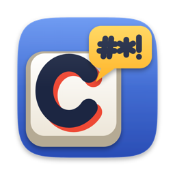

# Cerf Switcher

<p align="center">
  
</p>

<p align="center">
  <b>Local EN↔RU keyboard-layout fixer for macOS</b><br>
  Typed <code>ghbdtn</code>? Get <code>привет</code>. Everything runs on your Mac.
</p>

<p align="center">
  <a href="https://github.com/yelloduxx/CerfSwitcher/tags"></a>
  <a href="LICENSE"></a>
  
  
  
</p>

<p align="center">
  <a href="#english">English</a> · <a href="#русский">Русский</a>
</p>

---

## English

**Why "cerf"?** Type the Russian word «сука» while the keyboard is still in the English layout and you get `cerf`. That is exactly the mistake this app fixes.

Cerf Switcher is a menu-bar app that fixes words typed in the wrong keyboard layout. You can fix a word by hand with a double Shift, or let the app fix it automatically when you finish the word. Decoding, learning and settings stay on your Mac. There is no telemetry.

**Build 163:** includes the feedback, dictionary backup and shorter menu described below. Short manual-toggle checks passed in separate AppKit and WebKit hosts. The local installation is verified separately from those tests; other editors are not certified by them.

**Build 166:** rejects stale caret lookups after new input and repairs queued key payloads after manual layout switches. Selection replacement checks its result immediately instead of waiting a fixed 150 ms. New native tests use continuous phrases and check exact text, caret, layout, neighboring text, and clipboard contents. An auto-off control must fail the enabled-conversion oracle. See the [verification record](docs/verification/build-166-native-interaction.md) for results and limits.

### Manual conversion

| Action | Result |
|---|---|
| Type a word, tap **Shift** twice | The last word is converted |
| Tap **Shift** twice again | The word switches back |
| Select text, tap **Shift** twice | The selection is converted |

The trigger is configurable. It can be Shift, Option, Command or Control, either side or only the right one, with a single or double tap. Manual conversion works with any two installed layouts.

The menu shows the last attempt's time and result, without storing the word. A short notice explains manual refusal or an unverified edit. An accepted event is not reported as a verified replacement. Automatic conversion does not show a notice for every word.

Status stays in the menu, without a tooltip near the mouse pointer. Build 165 uses native Liquid Glass notices on macOS 26+ and masks both material and shadow on older systems, eliminating the rectangular corners behind the rounded content. Notices include dismiss and Undo when applicable, without taking keyboard focus.

Manual replacement does not use the clipboard. A readable selection can be replaced by targeted keyboard input if Accessibility leaves it unchanged. If the app cannot safely identify the text, it refuses the edit. Short native toggle tests pass in separate AppKit and WebKit editors; this does not certify every third-party text field.

### Automatic conversion

Turn it on in **Settings → Overview**. It is off by default.

A word is checked only when you press Space, Enter or Tab, never in the middle of a word. The decoder compares the text you typed with the same keys in the other layout. It weighs:

- word frequency;
- English (SCOWL) and Russian (Hunspell) dictionaries;
- character patterns;
- the language of the surrounding phrase;
- next-word statistics;
- your own corrections.

When the evidence is weak, it leaves the text alone. Some examples:

- `ghbdtn,` → `привет,`
- `ghbdtncnde.` → `приветствую` (the final `.` key is `ю`)
- `b` → `и` in Russian text, but `plan B` stays
- `ult` → `где`
- `ашпьфб` → `figma` and `n/l/` → `т.д.` inside Russian text
- `руку` and `here` stay, because both words are real

It never touches:

- passwords and secure fields;
- terminals, IDEs and password managers (an editable app list);
- URLs, e-mail addresses and file paths;
- code identifiers, camelCase and mixed-script words;
- ALL-CAPS acronyms, unless the other reading is one in common use (`ЗК` → `PR`).

### It learns from you

- **Manual conversion teaches a word pair.** After you fix a word by hand, that word converts automatically the next time.
- **Undo is negative feedback.** Undoing an automatic fix, or switching it back with double Shift, counts against that conversion.
- **Your own words.** A word that no dictionary knows becomes part of your personal dictionary after you type it and keep it on three separate occasions. Examples are slang and project terms. Password fields, secure input and excluded apps are never counted.
- **Saved-learning feedback.** A notice confirms when a global pair or an application exception was saved. Its Undo action removes only that change and refuses to overwrite a rule edited since then.
- **Backup and reset.** **Settings → Dictionary** contains learned-rule actions and a full personal backup. The backup includes learned pairs, personal words, your dictionary, word exceptions and app exceptions. Restore replaces those sections after confirmation; general settings stay unchanged. Older learned-rule JSON and word-list TXT files remain supported.

**Manual conversion only:** add either spelling of a pair, such as `here` or `руку`, in **Settings → Exceptions → Manual conversion only**. Neither spelling is converted automatically. Your configured manual trigger still toggles the word, but does not teach or reverse a rule. Capitalization and surrounding punctuation do not bypass the exclusion. Existing learned pairs remain stored but cannot override this list. The list replaces the former "Never convert these words" section and remains part of the full personal backup.

### Settings

Open them from the menu-bar icon → **Settings** (⌘,).

| Page | What it has |
|---|---|
| **Overview** | Permission status, automatic conversion, the layout flag at the cursor, per-app layout memory and launch at login. |
| **Keyboard** | The trigger key, right-side-only, double tap and the layout pair. |
| **Exceptions** | Apps where auto-conversion is off, manual-only words, and words to always convert. |
| **Dictionary** | Your words, learned pairs, personal words, backup and restore. |
| **Advanced** | Auto-conversion in apps without Accessibility (terminals, Electron), Remote Desktop mode (beta), sound, icon appearance, and the debug log. |
| **About** | Version, the GitHub link and update checks. |

The menu starts with readiness and the last attempt, followed by pause, exclusion for the current app, settings and the dictionary. Layouts are in a submenu. Sound and technical settings stay in the Settings window.

The interface comes in 16 languages. The new Settings window is fully translated into English and Russian. In the other languages its newer strings appear in English for now.

### Installation

There is no prebuilt release yet. Build from source with Xcode Command Line Tools on macOS 13 or later:

```bash
git clone https://github.com/yelloduxx/CerfSwitcher.git
cd CerfSwitcher
SIGN_ID="<your code-signing identity>" bash build_app.sh
ditto CerfSwitcher.app /Applications/CerfSwitcher.app
open /Applications/CerfSwitcher.app
```

The result is a universal app for Apple Silicon and Intel. Use the same signing identity for every update. macOS ties permissions to the signature, so a different identity makes you grant them again.

On first launch, grant two permissions in System Settings → Privacy & Security. The built-in assistant walks you through them.

1. **Accessibility** reads and replaces text.
2. **Input Monitoring** sees which keys you press.

**Coming from RuSwitcher Pro?** On first launch Cerf Switcher copies your settings, learned words and personal dictionary once. The old settings are left untouched. Quit the old app first, so that two switchers do not handle the same keys.

### Privacy

- No text leaves your Mac. There are no cloud models, statistics or analytics.
- The only network request is the optional update check against this GitHub repository. You can turn it off in **About**.
- Debug logs contain lengths and outcomes, never the words you type.

### For developers

```bash
swift test
python3 scripts/run_mixed_layout_event_stream_suite.py <corpus.tsv> --jobs 8
```

Native probes and settings snapshots use a separate test build, not the installed app:

```bash
bash scripts/build_test_host.sh
```

Its signed bundle lives in `.build/test-host/apps/CerfSwitcherTestHost.app`, with isolated test preferences. `Sources/RuSwitcherTestHost` contains the probe entry points; both configurations compile the same runtime in `Sources/RuSwitcher`. The release builder disables test mode, uses `.build/production`, and rejects binaries containing test entry points. Native input tests require an idle switcher session; they never stop the installed app implicitly.

`AGENTS.md` has the engineering notes: architecture, event delivery, safety gates, test harnesses and the release procedure. `THIRD_PARTY_NOTICES.md` lists the data sources: Google Books n-grams, SCOWL, LibreOffice Hunspell, Tatoeba and wordfreq. The optional InputMethodKit companion (`build_input_method.sh`) needs an Apple-issued signing identity to run.

### License

[MIT](LICENSE). Third-party data keeps its own licenses; see `THIRD_PARTY_NOTICES.md`.

---

## Русский

**Почему «cerf»?** Наберите «сука», забыв переключиться с английской раскладки, и получится `cerf`. Именно такие ошибки программа и исправляет.

Cerf Switcher живёт в строке меню и исправляет слова, набранные не в той раскладке. Слово можно исправить вручную двойным Shift или включить автоматическое исправление, которое срабатывает, когда вы дописали слово. Распознавание, обучение и настройки остаются на вашем Mac. Телеметрии нет.

**Build 163:** включает описанные ниже сообщения, общую резервную копию и сокращённое меню. Короткие проверки ручного переключения прошли в отдельных редакторах AppKit и WebKit. Локальная установка проверена отдельно; эти тесты не подтверждают работу во всех сторонних редакторах.

**Build 166:** запоздалый ответ о слове у курсора больше не сбрасывает новый ввод. Смена раскладки вручную учитывает уже стоящие в очереди клавиши. Замена выделения проверяется сразу, без обязательного ожидания 150 мс. Новые оконные тесты проверяют непрерывные фразы, точный текст, курсор, раскладку, соседний текст и неизменность буфера обмена. Контроль с выключенной автозаменой обязан провалить проверку рабочего режима. Результаты и ограничения описаны в [отчёте проверки](docs/verification/build-166-native-interaction.md).

### Ручная конвертация

| Действие | Результат |
|---|---|
| Набрать слово, нажать **Shift** два раза | Последнее слово сконвертировано |
| Ещё раз **Shift** два раза | Слово вернулось обратно |
| Выделить текст, нажать **Shift** два раза | Сконвертировано выделение |

Триггер настраивается. Это может быть Shift, Option, Command или Control, с любой стороны или только правая, одиночное или двойное нажатие. Ручная конвертация работает с любой парой установленных раскладок.

В меню видны время и результат последней попытки, без сохранения слова. Короткое сообщение объясняет отказ ручной замены или отсутствие подтверждения. Отправка события не считается подтверждённой заменой. При автоконверсии сообщения после каждого слова не появляются.

Статус остаётся в меню, без подсказки возле указателя мыши. В build 165 уведомления используют системный Liquid Glass на macOS 26+, а на старых системах маска скругляет и материал, и тень: прямоугольных углов за скруглённым содержимым больше нет. Крестик и кнопка отмены сохранены, фокус клавиатуры баннер не забирает.

Ручная замена не использует буфер обмена. Если Accessibility оставил читаемое выделение без изменений, оно заменяется направленным клавиатурным вводом. Если безопасно определить текст нельзя, программа отказывается от правки. Короткие проверки переключения прошли в отдельных редакторах AppKit и WebKit; это не гарантия для всех сторонних полей ввода.

### Автоконверсия

Включается в **Настройки → Обзор**. По умолчанию выключена.

Слово проверяется только после пробела, Enter или Tab, никогда посреди слова. Движок сравнивает набранный текст с теми же клавишами в другой раскладке. Он учитывает:

- частоту слов;
- английский (SCOWL) и русский (Hunspell) словари;
- буквенные сочетания;
- язык фразы вокруг;
- статистику следующих слов;
- ваши собственные исправления.

Если уверенности мало, текст остаётся как есть. Примеры:

- `ghbdtn,` → `привет,`
- `ghbdtncnde.` → `приветствую` (клавиша `.` в конце это `ю`)
- `b` → `и` в русском тексте, но `plan B` не трогается
- `ult` → `где`
- `ашпьфб` → `figma` и `n/l/` → `т.д.` в русском тексте
- `руку` и `here` остаются, потому что оба слова настоящие

Программа никогда не трогает:

- пароли и защищённые поля;
- терминалы, IDE и менеджеры паролей (список приложений редактируется);
- адреса сайтов, почту и пути к файлам;
- код, camelCase и слова со смешанными алфавитами;
- аббревиатуры ЗАГЛАВНЫМИ, если другое прочтение не известная аббревиатура (`ЗК` → `PR`).

### Учится у вас

- **Ручная конвертация учит пару слов.** После исправления вручную это слово в следующий раз сконвертируется автоматически.
- **Отмена учит в обратную сторону.** Если вы отменили автозамену или вернули слово двойным Shift, это считается сигналом против такой замены.
- **Ваши слова.** Слово, которого нет в словарях, попадает в личный словарь, если вы три раза в разное время набрали его и оставили как есть. Это может быть сленг или рабочие термины. Пароли, защищённый ввод и приложения-исключения не учитываются.
- **Подтверждение запоминания.** Сообщение появляется после сохранения глобального правила или исключения для приложения. Его можно сразу отменить. Отмена затрагивает только это изменение и не перезаписывает правило, которое успели изменить позднее.
- **Резервная копия и сброс.** Всё находится в **Настройки → Словарь**. Общая копия включает выученные пары, личные слова, пользовательский словарь, исключения слов и приложений. Восстановление заменяет эти разделы после подтверждения, но не общие настройки. Прежние JSON-файлы выученных пар и TXT-списки слов по-прежнему поддерживаются.

**Только ручное переключение:** добавьте одно из написаний пары, например `here` или `руку`, в **Настройки → Исключения → Только ручное переключение**. Автозамена не трогает оба варианта. Назначенная клавиша продолжает переключать слово вручную, но не создаёт и не меняет выученное правило. Регистр и знаки препинания не обходят запрет. Прежние выученные пары сохраняются, но не имеют приоритета над этим списком. Это дополненный прежний список «Никогда не конвертировать», он входит в общую резервную копию.

### Настройки

Открываются из иконки в строке меню → **Настройки** (⌘,).

| Раздел | Что внутри |
|---|---|
| **Обзор** | Статус разрешений, автоконверсия, флаг у курсора, раскладка по приложениям и автозапуск. |
| **Клавиатура** | Клавиша-триггер, только правая клавиша, двойной тап и пара раскладок. |
| **Исключения** | Приложения без автоконверсии, слова только для ручного переключения и слова, которые исправлять всегда. |
| **Словарь** | Свои слова, выученные пары, личные слова, резервная копия и восстановление. |
| **Дополнительно** | Автоконверсия в приложениях без Accessibility (терминалы, Electron), режим удалённого стола (бета), звук, оформление значка и журнал отладки. |
| **О программе** | Версия, ссылка на GitHub и проверка обновлений. |

В начале меню находятся готовность и результат последней попытки, затем пауза, исключение для текущего приложения, настройки и словарь. Раскладки собраны в подменю. Звук и технические параметры доступны в настройках.

Интерфейс есть на 16 языках. Новое окно настроек полностью переведено на русский и английский. На остальных языках его новые строки пока показываются по-английски.

### Установка

Готовой сборки пока нет. Соберите из исходников на macOS 13+ с Xcode Command Line Tools:

```bash
git clone https://github.com/yelloduxx/CerfSwitcher.git
cd CerfSwitcher
SIGN_ID="<ваш сертификат подписи>" bash build_app.sh
ditto CerfSwitcher.app /Applications/CerfSwitcher.app
open /Applications/CerfSwitcher.app
```

Получится universal-приложение для Apple Silicon и Intel. Подписывайте все обновления одним и тем же сертификатом. macOS привязывает разрешения к подписи, поэтому с другим сертификатом их придётся выдавать заново.

При первом запуске выдайте два разрешения в «Системных настройках → Конфиденциальность и безопасность». Встроенный помощник проведёт по шагам.

1. **Универсальный доступ** нужен, чтобы читать и заменять текст.
2. **Мониторинг ввода** нужен, чтобы видеть нажатия клавиш.

**Переходите с RuSwitcher Pro?** При первом запуске Cerf Switcher один раз скопирует ваши настройки, выученные слова и личный словарь. Старые настройки не меняются. Старое приложение сначала закройте, чтобы два переключателя не обрабатывали одни и те же клавиши.

### Приватность

- Текст не покидает ваш Mac. Нет облачных моделей, статистики и аналитики.
- Единственный сетевой запрос это необязательная проверка обновлений в этом репозитории на GitHub. Её можно выключить в разделе **«О программе»**.
- В журнал отладки попадают только длины и результаты, но никогда не набранные слова.

### Для разработчиков

```bash
swift test
python3 scripts/run_mixed_layout_event_stream_suite.py <corpus.tsv> --jobs 8
```

Нативные проверки и скриншоты настроек используют отдельную тестовую сборку, не установленное приложение:

```bash
bash scripts/build_test_host.sh
```

Подписанный стенд находится в `.build/test-host/apps/CerfSwitcherTestHost.app` и использует отдельные тестовые настройки. Проверочные режимы вынесены в `Sources/RuSwitcherTestHost`; обе сборки используют один рабочий код из `Sources/RuSwitcher`. Релиз собирается в `.build/production` с выключенным тестовым режимом и проверкой отсутствия тестового кода в бинарнике. Перед нативным вводом другие переключатели должны быть закрыты; сценарии не останавливают установленную программу автоматически.

В `AGENTS.md` собраны инженерные заметки: архитектура, доставка событий, защитные правила, тестовые стенды и порядок выпуска. `THIRD_PARTY_NOTICES.md` перечисляет источники данных: Google Books n-grams, SCOWL, LibreOffice Hunspell, Tatoeba и wordfreq. Для дополнительного Input Method (`build_input_method.sh`) нужен сертификат подписи от Apple.

### Лицензия

[MIT](LICENSE). Сторонние данные распространяются по своим лицензиям, см. `THIRD_PARTY_NOTICES.md`.
